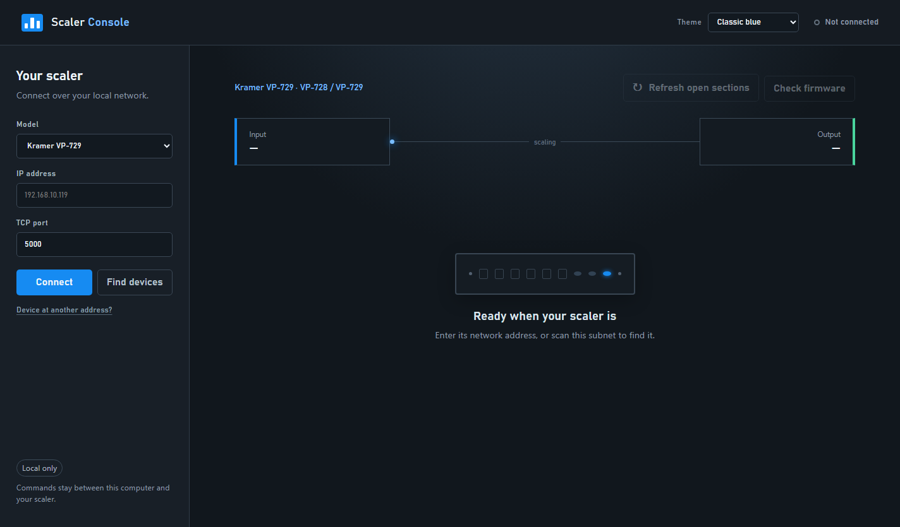
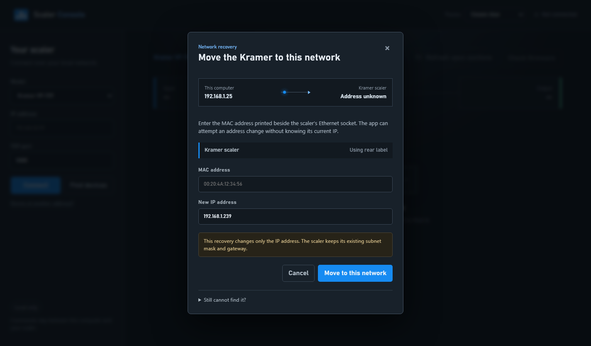

# Scaler Console

Scaler Console is a local Windows controller for Kramer video scalers. It gives older hardware a modern interface for input selection, picture and output settings, presets, diagnostics, firmware checks, and network recovery—without sending device control through a cloud service.

> **Beta software:** the current release is intended for hands-on testing with a Kramer VP-729. Read operations and everyday controls are implemented, but not every command has been verified against every firmware version and operating mode. Confirm the selected device and review prompts before using reset, timing, preset, or network actions.

## Screenshots



<details>
<summary>Network recovery</summary>



</details>

## What it does

- Connects directly to a scaler over the local network.
- Implements the Kramer VP-728/VP-729 legacy `Y` / `Z` command protocol.
- Covers the VP-729 command-set functions documented by Kramer, with unavailable controls identified instead of guessed.
- Organizes everyday controls separately from advanced picture, scaling, audio, geometry, timing, preset, diagnostic, and maintenance commands.
- Discovers Lantronix XPort modules on the local subnet and can safely assign a reachable private IP address.
- Provides a guided recovery path when the scaler is still using an address from another subnet.
- Reads installed VP-729 master and audio firmware and compares it with Kramer's published downloads.
- Includes 13 interface themes, including 11 Theme.Park palette adaptations.
- Runs as a self-contained Windows desktop app; no separate terminal or browser is required.

## Supported hardware

| Model | Status | Connection |
| --- | --- | --- |
| Kramer VP-729 | Beta | Ethernet, TCP port `5000` or `10001` |

The VP-728 uses the same documented command family, but the current profile and hardware testing target the VP-729.

**Need another scaler?** Open a [model request](../../issues/new?template=model-request.yml) with the exact manufacturer and model number, its control-protocol document if available, and the connection type you use. Additional Kramer scalers can be added on request.

## Install the Windows beta

1. Open the [GitHub releases](../../releases) page and select the newest beta.
2. Download `Scaler Console Setup 0.1.0.exe` from **Assets**.
3. Run the installer and choose an installation folder.
4. Launch **Scaler Console** from the desktop or Start menu.

Windows may show a SmartScreen warning while the beta does not have a widely trusted publisher certificate. Verify that the installer came from this repository's Releases page before running it.

## Quick start

1. Connect the computer and scaler to the same local network.
2. Open Scaler Console and leave **Kramer VP-729** selected.
3. Enter the scaler's private IPv4 address and its TCP port. Try `5000` first; some earlier units use `10001`.
4. Select **Connect**.
5. If the address is unknown, select **Find devices**. If the scaler is on another subnet, use **Device at another address?** and follow the recovery prompts.

The main controls load after connection. Additional groups stay collapsed until opened, and **Refresh open sections** reads only the groups currently in view.

## Safety and privacy

- Device commands are limited to private/local IPv4 addresses.
- Control traffic stays between the computer and scaler.
- The optional firmware check contacts Kramer's public download page; it does not send the scaler's address or settings.
- Reading and connecting do not change device settings.
- Save, recall, reset, risky timing, and network operations require explicit confirmation in the app.
- Settings are sent one at a time because the VP-729 protocol requires a reply prompt before the next command.
- A firmware result is reported as **unverified** if Kramer's current listing cannot be reached or parsed.
- Firmware installation is not performed over the control connection. Audio firmware requires physical access, a serial adapter, and Kramer's flashing procedure.

## Run from source

Requirements: Windows, macOS, or Linux with Node.js 20 or newer. The packaged desktop installer is currently Windows-only.

```bash
npm install
npm start
```

Then open <http://127.0.0.1:4173>.

For the Electron desktop shell:

```bash
npm run desktop
```

To build the Windows installer:

```bash
npm run dist:win
```

The installer is written to `dist/`.

## Architecture

```text
Desktop or browser UI
        │ HTTP on localhost
        ▼
Local Node.js service
        │ TCP on the private network
        ▼
Kramer scaler
```

- `public/` contains the responsive controller interface and themes.
- `src/profiles/` describes model capabilities and controls.
- `src/protocols/` encodes and parses device protocol families.
- `src/device-client.js` owns TCP communication, validation, and timeouts.
- `src/lantronix.js` handles local XPort discovery and safe IP assignment.
- `src/firmware.js` reads installed versions and verifies Kramer's published firmware.
- `electron/` packages the local service and interface as a desktop application.

Protocol 3000 models should use a separate protocol adapter while keeping the same profile and UI contract.

## Testing

```bash
npm test
```

The automated suite covers command formatting, response parsing, firmware comparison, private-network validation, Lantronix discovery/configuration records, and theme restoration.

Hardware behavior can still vary with scaler firmware, active input, and operating mode. When reporting a problem, include the model, firmware versions, connection port, the action attempted, and the exact error shown by Scaler Console. Do not post public IP addresses, passwords, or other credentials.

## Reference material

- [Kramer VP-728/VP-729 RS-232 command set v2.7](https://cdn.kramerav.com/web/downloads/protocols/vp-728_729_rs-232_command_set_2014-0521.pdf)
- [Kramer VP-729 product downloads](https://k.kramerav.com/support/product_downloads.asp?pid=1062&pt=5)
- [Kramer VP-728/VP-729 release notes](https://cdn.kramerav.com/web/downloads/releaseNotes/vp-728__vp-729_release_notes1.pdf)

Theme.Park palette adaptations are distributed under the included MIT license in `public/third-party-licenses/theme.park.txt`.
